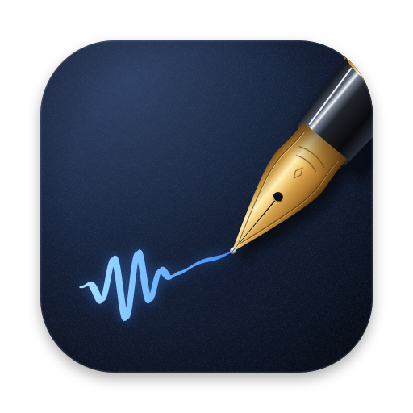

# Skrift

**Free, private, unlimited transcription** for YouTube videos, Twitch VODs and your own video or audio files.
No account, no subscription, no limits, no uploads: everything runs on your own computer.

Paste a link (or drop in a file) and Skrift writes down every word, cross-checks it with several independent
speech engines, points you to the few spots worth a second look, and exports **subtitles (SRT, VTT), Word, PDF,
plain text, Markdown or JSON** with word timings.

## Download

Get the latest version from the **[Releases page](../../releases/latest)**:

| Your computer | Download | First time you open it |
|---|---|---|
| **Mac** with an Apple chip (M1 or newer), macOS 14+ | `Skrift-mac.zip` | Unzip it and drag **Skrift** into Applications, then open it. macOS will say it can't check the app (Skrift is free, so it isn't paid-signed by Apple): open **System Settings → Privacy & Security**, scroll down, click **Open Anyway** next to Skrift, and confirm. You only do this once. |
| **Windows** 10 or 11 (64-bit Intel/AMD) | `Skrift-windows.zip` | Right-click the zip → **Extract All**, open the folder and double-click **Start Skrift**. If Windows shows "Windows protected your PC", click **More info → Run anyway**. Keep the small black window open while you use Skrift. |

The first launch sets Skrift up by itself: a page opens in your browser and shows the progress while it installs
its engines (a few minutes, about 8 GB of downloads). After that, Skrift opens in a few seconds and works offline
(except, of course, for downloading videos).

## Using it

1. Paste one or more YouTube or Twitch links, or drop in a video/audio file (OBS recordings, podcasts, interviews…).
2. Skrift downloads only the audio and transcribes it. You can close the tab and it keeps working (on a Mac you'll
   get a notification when it's done).
3. Open the transcript. The few spots where the engines still disagree are highlighted: press **N** to jump to
   the next one, listen, then **Enter** to keep it, **A** to take the other version, or just type a fix.
4. Export in the format you need. Your edits are included.

Also: find & replace (with "remember this spelling" for next time), a names list for channel names and people the
engines don't know, search across all your transcripts, and an optional bleep for swear words in subtitles.

## How it gets the words right

Every transcript is written by one engine and checked by others, word by word:

- **NVIDIA Parakeet TDT 0.6B v2** writes the transcript (the most accurate English model we measured).
- **OpenAI Whisper large-v3-turbo** transcribes it again independently.
- A **third vote** breaks ties: YouTube's own captions when the video is on YouTube, otherwise Whisper large-v3.
- An **AI meaning check** (Google's Gemma 4, running locally) reads each remaining disagreement in context and picks
  the version that makes sense ("addition" vs "edition"). It only chooses between versions an engine actually
  heard, never invents words, and names are left for you to decide.

Measured against human-made captions (word error rate, lower is better):

| Test audio | Skrift | Parakeet alone | Whisper large-v3 alone |
|---|---|---|---|
| 47-minute Nintendo Direct (narration over game audio) | **3.0%** | 3.5% | 4.8% |
| 67-minute 4-person gaming podcast, crosstalk\* | **6.3%** | 6.8% | 8.3% |

\* those captions leave out filler words and repeats, so part of that number is the reference, not the transcript.

Speed: on an M3 MacBook, a 15-minute video takes about 3 minutes. On Windows everything runs on the processor.
On GitHub's basic 2-core Windows test machine, 2½ minutes of speech took about 50 seconds to transcribe and
another 1½–3 minutes to cross-check (those machines vary that much). The tie-breaker only listens where the two
engines disagree, so on clear audio it adds very little. Most desktop and gaming PCs have far more cores than that
test machine. **Fast** mode (one engine, no cross-check) takes about a third of the video's length even there.
The AI check uses your graphics card when Windows can (NVIDIA, AMD or Intel); without one it takes about 20 seconds
per spot on that basic machine. Skrift works at low priority, so games, OBS and your browser stay smooth while it runs.

## Privacy

- Your audio, transcripts and settings never leave your computer. There is no Skrift server, account or tracking.
- Skrift only listens to your own computer (it isn't reachable from your network), unless you turn on
  **Settings → Allow other devices on my Wi-Fi** to open it from your phone.
- The only internet traffic is downloading the videos you ask for, Skrift's engines on first launch, and keeping
  the video downloader (yt-dlp) up to date.

## Good to know

- **Members-only or subscriber-only videos:** Settings → use your browser's login, so Skrift can download what you can
  watch. On Windows, use Firefox for this: Chrome and Edge keep their logins locked away from other apps.
- **Other languages:** choose *Other* when adding a video (one Whisper large-v3 pass, language detected automatically).
- **Live streams** can be transcribed once the VOD is available.
- **Needs** about 8 GB of memory (16 GB recommended) and about 12 GB of free disk space.
- **Not supported yet:** Intel Macs and Windows on ARM. Linux works from source (see below).
- **Your data lives in:** Mac `~/Library/Application Support/Skrift`, Windows `%LOCALAPPDATA%\Skrift`.
  To uninstall, delete the app (or folder) and that data folder.

## Feedback

Questions, ideas, or how Skrift worked for you: post on the [Discussions](../../discussions) page
([Q&A](../../discussions/categories/q-a), [Ideas](../../discussions/categories/ideas),
[Show and tell](../../discussions/categories/show-and-tell)). Something broken? Open an [issue](../../issues) and
mention your computer (Mac or Windows), what you were transcribing, and any error message.

## For developers

- `python3 deploy/build_release.py` builds the downloads into `dist/` (add `--linux` for the Linux one). Each
  bundles the official [uv](https://github.com/astral-sh/uv), which installs Python and the locked packages
  (`pyproject.toml` + `uv.lock`) into the user's data folder on first launch.
- `python3 deploy/ci_smoke.py <unpacked download>` installs a download from scratch like a new user and checks
  a real transcription, every export, the AI check, and that nothing outside the computer can reach it.
  `.github/workflows/release.yml` runs it on GitHub's Windows machines and attaches the downloads to a release
  when a `v*` tag is pushed.
- Apple-chip Macs use MLX (`parakeet-mlx`, `mlx-whisper`, `mlx-lm`); Windows and Linux run the same models
  through `sherpa-onnx`, `faster-whisper` and llama.cpp's `llama-server` (`skrift/portable.py`, `skrift/llm_server.py`).

## License

Skrift is free software under the [GNU General Public License v3](LICENSE): anyone can use it, share it and
change it, for free. If you share a changed version, it has to stay free and open source too.

## Built on

[Parakeet TDT 0.6B v2](https://huggingface.co/nvidia/parakeet-tdt-0.6b-v2) (NVIDIA, CC-BY-4.0) ·
[Whisper](https://github.com/openai/whisper) (OpenAI) · [Gemma 4](https://ai.google.dev/gemma) (Google) ·
[yt-dlp](https://github.com/yt-dlp/yt-dlp) · [MLX](https://github.com/ml-explore/mlx) ·
[sherpa-onnx](https://github.com/k2-fsa/sherpa-onnx) · [faster-whisper](https://github.com/SYSTRAN/faster-whisper) ·
[llama.cpp](https://github.com/ggml-org/llama.cpp) · [uv](https://github.com/astral-sh/uv) · FFmpeg · FastAPI.
Each model and tool keeps its own license.
